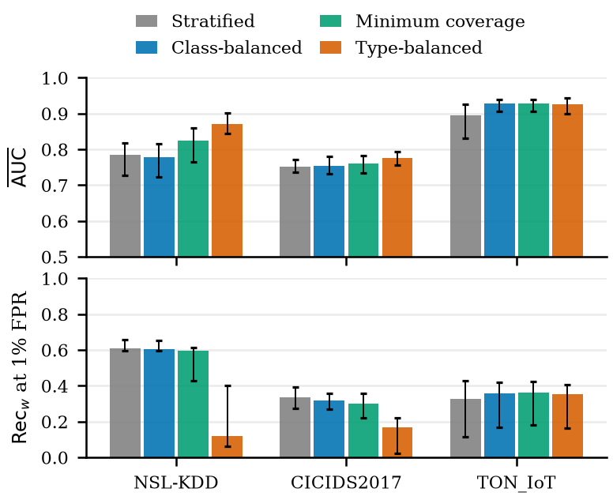

# How Sampling Affects QCNN Intrusion Detection

Code and results for

> **How Sampling Affects QCNN Intrusion Detection**
> Hyungsuk Lee, In-Nea Wang, Junho Jeong (Dongguk University)
> Submitted to ICAIIC 2027. The paper will be linked here after review.

A quantum convolutional neural network (QCNN) can be trained on only a few thousand
records, so which records go into the training subset is a design choice. We compare
four sampling policies in a paired design: stratified (ST), class-balanced (CB),
minimum coverage (MC), and type-balanced (TB). The experiment covers three datasets,
five QCNN ansätze, and subset sizes from 50 to 5,000, for 1,500 models in total.

Type balancing raises the type-averaged AUC but lowers recall at a 1% false-positive
rate (FPR) on NSL-KDD and CICIDS2017. The loss comes from moving attack records away
from frequent types, not from including every type, and it holds for all five ansätze.

| Median over 125 models | NSL-KDD AUC | NSL-KDD Rec<sub>w</sub> | CICIDS2017 AUC | CICIDS2017 Rec<sub>w</sub> | TON_IoT AUC | TON_IoT Rec<sub>w</sub> |
|---|---|---|---|---|---|---|
| Stratified       | 0.79 | 0.61 | 0.75 | 0.34 | 0.89 | 0.32 |
| Class-balanced   | 0.78 | 0.61 | 0.75 | 0.32 | 0.93 | 0.36 |
| Minimum coverage | 0.82 | 0.60 | 0.76 | 0.30 | 0.93 | 0.36 |
| Type-balanced    | 0.87 | 0.12 | 0.78 | 0.17 | 0.93 | 0.35 |

AUC is averaged over attack types. Rec<sub>w</sub> is recall at a 1% FPR, weighted by
the test attack mixture. This is Table II of the paper (`tables/overall.tex`).

<p align="center"></p>

## Repository layout

```
src/                 data loading and preprocessing, the four sampling policies, QCNN training and metrics
QCNN/                circuits of Hur et al. (2022), vendored unmodified (Apache 2.0, see QCNN/NOTICE.md)
experiments/run.py   main experiment: 4 policies x 5 ansätze x 5 subset sizes x 5 seeds per dataset
experiments/checks.py  robustness checks and the classical CNN baseline (paper Sec. V)
analysis/            tables, figures and every number cited in the paper, from results/
results/main/        the 1,500 models of the main experiment
results/checks/      robustness checks and the classical baseline
results/replication/ summary of the earlier unpaired experiment (paper Sec. IV-A)
tables/, figures/    output of analysis/make_assets.py (Tables II-IV, Figs. 1-3)
data/SHA256SUMS      checksums of the raw files used
```

`results/README.md` describes every result file.

## Reproducing the paper's tables and figures

The released results are enough; no dataset download or training is needed.

```
pip install -r requirements.txt
python -m analysis.make_assets   # tables/, figures/, analysis/numbers.json
python -m analysis.checks        # robustness checks and CNN baseline, analysis/checks.json
```

With the versions in `requirements.txt`, `make_assets` reproduces the paper's table files
and figure PNGs byte for byte.

## Rerunning the experiment

### 1. Data

The raw datasets are not redistributed here. Place them as follows and check them with
`sha256sum -c data/SHA256SUMS`.

| Dataset | Source | Location |
|---|---|---|
| NSL-KDD | https://www.unb.ca/cic/datasets/nsl.html | `data/raw/KDDTrain+.txt`, `data/raw/KDDTest+.txt` |
| CICIDS2017 | https://www.unb.ca/cic/datasets/ids-2017.html (MachineLearningCVE, eight CSV files) | `data/raw/cicids2017/*.csv` |
| TON_IoT | Train_Test_Network file, from the Hugging Face mirror `codymlewis/TON_IoT_network` | `data/raw/toniot/train_test_network.csv` |

The TON_IoT file we used has 211,043 rows, 50,000 of them normal. The original
release describes 300,000 normal records in this file; the attack rows are the same.
This difference is also stated in the paper.

### 2. Training

```
python -m experiments.run --dataset NSL-KDD                  # 500 models
python -m experiments.run --dataset NSL-KDD --seed 42        # one of the five seeds, to run seeds in parallel
python -m experiments.run --dataset CICIDS2017 --n 50 --circuits U_TTN --policies balance uniform
```

Each model takes about 10 s (circuit 1) to 30 s (circuit 9) on one CPU core. The code
fixes every seed: subsets, initial parameters, mini-batch positions, and the evaluation
set. We checked that it rebuilds the evaluation sets and all 1,500 training subsets of
the released results exactly, and that retrained models give the released scores to the
last bit with the versions in `requirements.txt`. Each released JSON file lists, for
every attack type, the number of records of that type in the training subset, so the
sampling can be checked without training anything.

### 3. Robustness checks and classical baseline

```
python -m experiments.checks rescore  --dataset NSL-KDD    # thresholds from 10,000 training-pool benign records, 0.1% target
python -m experiments.checks long     --dataset NSL-KDD    # 1,000 training iterations at N = 500
python -m experiments.checks cnn      --dataset NSL-KDD    # one-layer CNN on the same CB, MC and TB subsets
python -m experiments.checks fullpool --dataset NSL-KDD    # the same CNN on the entire training pool
```

The 1,024-shot check resamples the released scores inside `analysis/checks.py`.

## Protocol in brief

- **Preprocessing.** One-hot encoding, MinMax scaling and PCA to eight components, all
  fitted on the training pool, then scaling to [-π, π]. NSL-KDD uses KDDTrain+ and
  KDDTest+. CICIDS2017 and TON_IoT are split 80:20, stratified by class (seed 42).
- **Sampling.** Within a dataset, subset size N and seed, the four subsets start from
  the same class-balanced draw. MC replaces the fewest attack records needed to include
  every type. TB spreads the attack half evenly across types. ST switches records to the
  other class until the pool's attack ratio is reached. Records shared by two subsets
  keep their positions in the training order. See `src/sampling.py`.
- **Model.** Eight-qubit QCNN with angle encoding and three convolution-pooling layers
  (Hur et al., 2022). Convolutional circuits 1, 3, 6, 7 and 9 give 12 to 51 parameters.
  Training uses Nesterov momentum, learning rate 0.01, 200 iterations, mini-batches of 25
  and mean squared error, in PennyLane's noiseless simulator.
- **Evaluation.** Up to 400 test attacks per type seen in training, plus 3,000 test
  benign records. The threshold is the 1,485th of 1,500 benign scores, which gives
  a 1% FPR. The FPR is measured on the other 1,500 benign records.

## Earlier version

An earlier draft, *Ansatz Expressivity and Dataset-Dependent Scaling of QCNN
Competitiveness in Network Intrusion Detection*, studied stratified subsets only and
compared QCNNs with classical models. Its code and results are kept under the git tag
[`v1-ansatz-scaling`](../../tree/v1-ansatz-scaling).

## License

Code: MIT (see `LICENSE`). `QCNN/` is Apache 2.0 (see `QCNN/LICENSE.md`).
